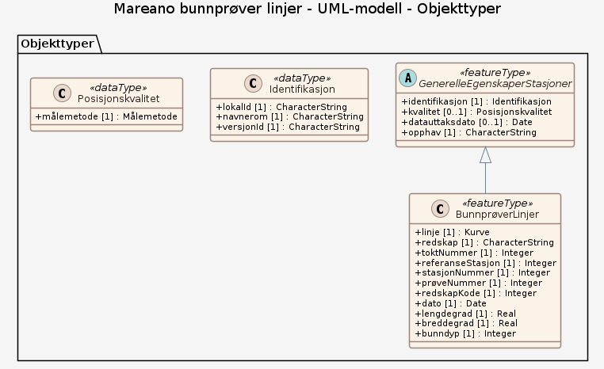

# Produktspesifikasjon: Mareano bunnprøver linjer

*Datasettet viser georefererte bunnprøvelinjer der MAREANO har samlet inn bunnprøver fra ulike tauede redskap (f.eks. bomtrål, slede, grabb, video-rigg). Bunnprøver tas med tauede redskaper som bomtrål og RP-slede. Video-opptak med en tauet video-rigg.*

**Nøkkelord:** Bomtrål, RP-slede, Video-rigg, grabb, Mareano, Norge digitalt, fellesDatakatalog, Kyst og fiskeri, Natur, GenerelleEgenskaperStasjoner, BunnprøverLinjer, linje, redskap, toktNummer, referanseStasjon, stasjonNummer, prøveNummer, redskapKode, dato, lengdegrad, breddegrad, bunndyp, Norge

**Emnekategorier:** Biologisk mangfold

**Geografisk utstrekning**:

- **Vest**: 1.0
- **Øst**: 37.0
- **Sør**: 58.5
- **Nord**: 81.75

**Geografisk område**:
Norske havområder.

**Tidsmessig utstrekning**:

- **Tidsperiode**:
  - **Fra**: 2021-05-11
  - **Til**: 2026-05-24

## Om spesifikasjonen

> **Denne versjonen av produktspesifikasjonen:**  
> **Opprettet dato:** 2021-05-11 
> **Endret dato:** 2026-05-24 
> **Språk:** nor 
> **Kontaktinformasjon:** Havforskningsinstituttet, [kjell.bakkeplass@hi.no](mailto:kjell.bakkeplass@hi.no)

## Om produktet Mareano bunnprøver linjer

> **Romlig representasjonstype:** Vektor 
> **Unik identifikator:** <https://data.geonorge.no/sosi/natur/mareano_bunnprover_linjer> 
> **Kontaktinformasjon:** Havforskningsinstituttet, [kjell.bakkeplass@hi.no](mailto:kjell.bakkeplass@hi.no)
>
> **Romlig oppløsning:**
>
> **Ekvivalent målestokk**: 500000
>
> **Begrensninger:**
>
> **Ressursbegrensninger**:
>
> - **Bruksbegrensninger**: Ingen begrensninger på bruk er oppgitt.
>
> **Juridiske begrensninger**:
>
> - **Tilgangsbegrensninger**: Åpne data
> - **Bruksbegrensninger**: Lisens
> - **Lisens**: Norsk lisens for offentlige data (NLOD)
> - **Lisenslenke**: <http://data.norge.no/nlod/no/1.0>
>
> **Sikkerhetsbegrensninger**:
>
> - **Klassifisering**: Ugradert

### Formål

MAREANO samler inn fysiske prøver fra bunnen og video-opptak for å kartlegge av geologi og bunnfauna. Bunnprøver tas med tauede redskaper som bomtrål og RP-slede. Video-opptak med en tauet video-rigg.

## Omfang

### Hele datasettet

**Nivå**: dataset

**Nivåbeskrivelse**: Gjelder hele datasettet. Hvis omfang ikke er oppgitt under en overskrift, gjelder teksten for hele datasettet og alle leveranser

### UML-modell

**Nivå**: dataset

## Datainnhold og struktur

### Datamodell - UML-modell

➡️ [Se full datamodell for omfang "UML-modell" (diagram per pakke og objektkatalog)](uml-modell/objektkatalog.html)

## Referansesystem

| EPSG-kode | Navn på referansesystem |
| --- | --- |
| [EPSG:25833](https://epsg.io/25833) | [EUREF89 UTM sone 33, 2d](https://register.geonorge.no/epsg-koder) |
| [EPSG:3035](https://epsg.io/3035) | [EUREF89 / ETRS89-LAEA Europe](https://register.geonorge.no/epsg-koder) |
| [EPSG:4258](https://epsg.io/4258) | [EUREF 89 Geografisk (ETRS 89) 2d](https://register.geonorge.no/epsg-koder) |

## Datakvalitet

**Nivå**: dataset

**Kvalitetsmål**: SOSI produktspesifikasjon: Mareano bunnprøver linjer

- **Beskrivende resultat**: Dataene er i henhold til produktspesifikasjonen

**Kvalitetsmål**: Sosi applikasjonsskjema

- **Beskrivende resultat**: SOSI-filer er i henhold til applikasjonsskjema

**Kvalitetsmål**: Sosi applikasjonsskjema

- **Beskrivende resultat**: GML-filer er i henhold til applikasjonsskjema

**Kvalitetsmål**: Prosentvis oppfyllelse av FAIR-prinsipper

- **Målebeskrivelse**: Angir fullstendighet i forhold til krav fra FAIR-prinsippene (The FAIR Guiding Principles for scientific data management and stewardship)
- **Resultat**: 98

## Datafangst og produksjon

Datasettet viser georefererte linjer der det er tatt prøver i de områder som MAREANO har kartlagt. Datasettet er ikke heldekkende. Dekningsgrad avhenger av hvilken kartleggingsinnsats som er lagt ned innenfor de forskjellige områdene. Datasettet egner seg til bruk i målestokk 500 000 - 10 000 000.

## Vedlikehold

**Vedlikeholdsfrekvens**: Årlig

**Status**: Fullført

## Presentasjon

**navn**: Tegneregler

**Lenke**:
<https://register.geonorge.no/register/versjoner/tegneregler/havforskningsinstituttet/mareano-bunnprøver-linjer>

## Leveranse

| Tjeneste | Endepunkt | Type | Format | Leveranseenheter |
| --- | --- | --- | --- | --- |
| Geonorge nedlastning | [Lenke](https://nedlasting.geonorge.no/api/capabilities/06aed811-f575-4fc8-99b3-3379f61e401c) | GEONORGE:DOWNLOAD | FGDB, GML, PostGIS, SOSI | landsfiler |
| Atom Feed | [Lenke](http://nedlasting.geonorge.no/geonorge/ATOM-feeds/MareanoBunnproverLinjer_AtomFeedFGDB.xml) | W3C:AtomFeed | FGDB | landsfiler |
| Atom Feed | [Lenke](http://nedlasting.geonorge.no/geonorge/ATOM-feeds/MareanoBunnproverLinjer_AtomFeedGML.xml) | W3C:AtomFeed | GML | landsfiler |
| Atom Feed | [Lenke](http://nedlasting.geonorge.no/geonorge/ATOM-feeds/MareanoBunnproverLinjer_AtomFeedPOSTGIS.xml) | W3C:AtomFeed | PostGIS | landsfiler |
| Atom Feed | [Lenke](http://nedlasting.geonorge.no/geonorge/ATOM-feeds/MareanoBunnproverLinjer_AtomFeedSOSI.xml) | W3C:AtomFeed | SOSI | landsfiler |
| Mareano bunnprøver linjer WMS | [Lenke](https://kart.hi.no/mareano/mareano_stasjoner/bunnprover_linjestasjoner/wms?service=WMS&request=GetCapabilities) | WMS-tjeneste | PNG |  |
| GeoPackage: uml-modell | [Lenke](https://raw.githubusercontent.com/ToreFreddyB/produktspesifikasjon_HI/main/produktspesifikasjon/mareano-bunnprover-linjer/uml-modell/uml-modell.gpkg) | Nedlasting | GPKG |  |
| PostGIS-skript: uml-modell.postgis | [Lenke](https://raw.githubusercontent.com/ToreFreddyB/produktspesifikasjon_HI/main/produktspesifikasjon/mareano-bunnprover-linjer/uml-modell/uml-modell.postgis.sql) | Nedlasting | SQL |  |
| GML/XSD-skjema: uml-modell | [Lenke](https://raw.githubusercontent.com/ToreFreddyB/produktspesifikasjon_HI/main/produktspesifikasjon/mareano-bunnprover-linjer/uml-modell/schema/xsd/INPUT/uml-modell.xsd) | Nedlasting | XSD |  |

## Metadata

**Metadatastandard**: ISO19115

**Metadatastandardversjon**: 2003

**Metadatadato**: 2026-10-16

**språk**: nor

**Kontakt**:

- **Organisasjon**: Havforskningsinstituttet
- **Kontaktperson**: Kjell Bakkeplass
- **Logo**: <https://register.geonorge.no/data/organizations/971349077_hi_liten.png>
- **Epost**: kjell.bakkeplass@hi.no
- **rolle**: pointOfContact

**Metadataidentifikator**:

- **Utsteder**: Geonorge
- **kode**: 06aed811-f575-4fc8-99b3-3379f61e401c
- **koderom**: <https://kartkatalog.geonorge.no/metadata/>
- **Metadatalenke**: <https://kartkatalog.geonorge.no/metadata/06aed811-f575-4fc8-99b3-3379f61e401c>

## Tilleggsinformasjon

- **Produktark:** [https://register.geonorge.no/register/versjoner/produktark/havforskningsinstituttet/mareano-bunnprøver-linjer](https://register.geonorge.no/register/versjoner/produktark/havforskningsinstituttet/mareano-bunnprøver-linjer)
- **Produktside:** [https://www.mareano.no/om_mareano/aktivitet/arbeidsmater/rekkefolge-pa-innsamlingen](https://www.mareano.no/om_mareano/aktivitet/arbeidsmater/rekkefolge-pa-innsamlingen)
