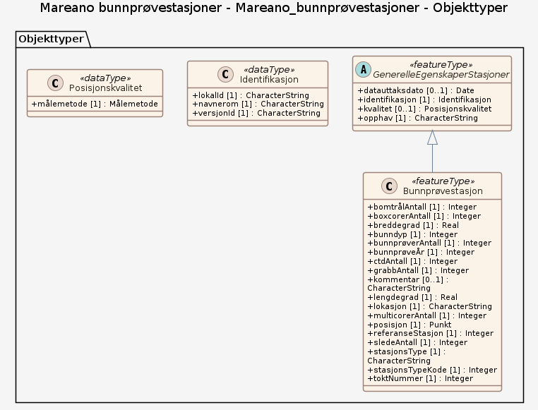

# Produktspesifikasjon: Mareano bunnprøvestasjoner

*Bunnprøvestasjoner tatt på Mareano-tokt pr. år.  Datasettet viser referansestasjoner der MAREANO har samlet inn ett sett med fysiske bunnprøver fra ulike redskap (f.eks. bomtrål, slede, grabb, boxcorer, multicorer). Referansestasjonen er som regel forhåndsbestemt før toktene utfra tolkning av data fra mulitistråleekkolodd.*

**Nøkkelord:** Bomtrål, Slede, grabb, boxcprer, multicorer, Mareano, Norge digitalt, fellesDatakatalog, Natur, Kyst og fiskeri, Bunnprøvestasjon, referanseStasjon, toktNummer, ctdAntall, bomtrålAntall, boxcorerAntall, grabbAntall, multicorerAntall, sledeAntall, bunnprøverAntall, bunndyp, stasjonsType, stasjonsTypeKode, bunnprøveÅr, Norge

**Emnekategorier:** Kyst og sjø

**Geografisk utstrekning**:

- **Vest**: 1.0
- **Øst**: 37.0
- **Sør**: 58.5
- **Nord**: 81.75

**Geografisk område**:
Norske havområder.

**Tidsmessig utstrekning**:

- **Tidsperiode**:
  - **Fra**: 2021-04-20
  - **Til**: 2026-05-24

## Om spesifikasjonen

> **Denne versjonen av produktspesifikasjonen:**  
> **Opprettet dato:** 2021-04-20 
> **Endret dato:** 2026-05-24 
> **Språk:** nor 
> **Kontaktinformasjon:** Havforskningsinstituttet, [kjell.bakkeplass@hi.no](mailto:kjell.bakkeplass@hi.no)

## Om produktet Mareano bunnprøvestasjoner

> **Romlig representasjonstype:** Vektor 
> **Unik identifikator:** <https://data.geonorge.no/sosi/natur/mareano_bunnprovestasjoner> 
> **Kontaktinformasjon:** Havforskningsinstituttet, [kjell.bakkeplass@hi.no](mailto:kjell.bakkeplass@hi.no)
>
> **Romlig oppløsning:**
>
> **Ekvivalent målestokk**: 500000
>
> **Begrensninger:**
>
> **Ressursbegrensninger**:
>
> - **Bruksbegrensninger**: Ingen begrensninger på bruk er oppgitt.
>
> **Juridiske begrensninger**:
>
> - **Tilgangsbegrensninger**: Åpne data
> - **Bruksbegrensninger**: Lisens
> - **Lisens**: Norsk lisens for offentlige data (NLOD)
> - **Lisenslenke**: <http://data.norge.no/nlod/no/1.0>
>
> **Sikkerhetsbegrensninger**:
>
> - **Klassifisering**: Ugradert

### Formål

Datasettet viser hvor MAREANO har foretatt fysiske innsamlinger og brukes til å koble sammen de ulike prøvetakningene og antallet som er foretatt på denne referansestasjonen.

## Omfang

### Hele datasettet

**Nivå**: dataset

**Nivåbeskrivelse**: Gjelder hele datasettet. Hvis omfang ikke er oppgitt under en overskrift, gjelder teksten for hele datasettet og alle leveranser

### Mareano_bunnprøvestasjoner

**Nivå**: dataset

## Datainnhold og struktur

### Datamodell - Mareano_bunnprøvestasjoner

➡️ [Se full datamodell for omfang "Mareano_bunnprøvestasjoner" (diagram per pakke og objektkatalog)](mareano-bunnprvestasjoner/objektkatalog.html)

## Referansesystem

| EPSG-kode | Navn på referansesystem |
| --- | --- |
| [EPSG:25833](https://epsg.io/25833) | [EUREF89 UTM sone 33, 2d](https://register.geonorge.no/epsg-koder) |
| [EPSG:3035](https://epsg.io/3035) | [EUREF89 / ETRS89-LAEA Europe](https://register.geonorge.no/epsg-koder) |
| [EPSG:4258](https://epsg.io/4258) | [EUREF 89 Geografisk (ETRS 89) 2d](https://register.geonorge.no/epsg-koder) |

## Datakvalitet

**Nivå**: dataset

**Kvalitetsmål**: SOSI produktspesifikasjon: Mareano bunnprøvestasjoner

- **Beskrivende resultat**: Dataene er i henhold til produktspesifikasjonen

**Kvalitetsmål**: Sosi applikasjonsskjema

- **Beskrivende resultat**: SOSI-filer er i henhold til applikasjonsskjema

**Kvalitetsmål**: Sosi applikasjonsskjema

- **Beskrivende resultat**: GML-filer er i henhold til applikasjonsskjema

**Kvalitetsmål**: Prosentvis oppfyllelse av FAIR-prinsipper

- **Målebeskrivelse**: Angir fullstendighet i forhold til krav fra FAIR-prinsippene (The FAIR Guiding Principles for scientific data management and stewardship)
- **Resultat**: 98

## Datafangst og produksjon

Datasettet viser referansestasjoner (punkter) der det er tatt prøver i de områder som MAREANO har kartlagt. Datasettet er ikke heldekkende. Dekningsgrad avhenger av hvilken kartleggingsinnsats som er lagt ned innenfor de forskjellige områdene. Posisjonen er angitt som midtposisjonen for videotransektet på referansestasjonen.

## Vedlikehold

**Vedlikeholdsfrekvens**: Årlig

**Status**: Fullført

## Presentasjon

**navn**: Tegneregler

**Lenke**:
<https://register.geonorge.no/register/versjoner/tegneregler/havforskningsinstituttet/mareano-bunnprøvestasjoner>

## Leveranse

| Tjeneste | Endepunkt | Type | Format | Leveranseenheter |
| --- | --- | --- | --- | --- |
| Geonorge nedlastning | [Lenke](https://nedlasting.geonorge.no/api/capabilities/1f9e17d4-bf56-4bf4-a2a8-7d17a0873761) | GEONORGE:DOWNLOAD | FGDB, GML, PostGIS, SOSI | landsfiler |
| Atom Feed | [Lenke](http://nedlasting.geonorge.no/geonorge/ATOM-feeds/MareanoBunnprovestasjoner_AtomFeedFGDB.xml) | W3C:AtomFeed | FGDB | landsfiler |
| Atom Feed | [Lenke](http://nedlasting.geonorge.no/geonorge/ATOM-feeds/MareanoBunnprovestasjoner_AtomFeedGML.xml) | W3C:AtomFeed | GML | landsfiler |
| Atom Feed | [Lenke](http://nedlasting.geonorge.no/geonorge/ATOM-feeds/MareanoBunnprovestasjoner_AtomFeedPOSTGIS.xml) | W3C:AtomFeed | PostGIS | landsfiler |
| Atom Feed | [Lenke](http://nedlasting.geonorge.no/geonorge/ATOM-feeds/MareanoBunnprovestasjoner_AtomFeedSOSI.xml) | W3C:AtomFeed | SOSI | landsfiler |
| Mareano bunnprøvestasjoner WMS | [Lenke](https://kart.hi.no/mareano/mareano_stasjoner/bunnstasjoner_aarlig/wms?service=WMS&request=GetCapabilities) | WMS-tjeneste | PNG |  |
| GeoPackage: mareano-bunnprvestasjoner | [Lenke](https://raw.githubusercontent.com/ToreFreddyB/produktspesifikasjon_HI/main/produktspesifikasjon/mareano-bunnprovestasjoner/mareano-bunnprvestasjoner/mareano-bunnprvestasjoner.gpkg) | Nedlasting | GPKG |  |

## Metadata

**Metadatastandard**: ISO19115

**Metadatastandardversjon**: 2003

**Metadatadato**: 2026-10-21

**språk**: nor

**Kontakt**:

- **Organisasjon**: Havforskningsinstituttet
- **Kontaktperson**: Kjell Bakkeplass
- **Logo**: <https://register.geonorge.no/data/organizations/971349077_hi_liten.png>
- **Epost**: kjell.bakkeplass@hi.no
- **rolle**: pointOfContact

**Metadataidentifikator**:

- **Utsteder**: Geonorge
- **kode**: 1f9e17d4-bf56-4bf4-a2a8-7d17a0873761
- **koderom**: <https://kartkatalog.geonorge.no/metadata/>
- **Metadatalenke**: <https://kartkatalog.geonorge.no/metadata/1f9e17d4-bf56-4bf4-a2a8-7d17a0873761>

## Tilleggsinformasjon

- **Produktark:** [https://register.geonorge.no/register/versjoner/produktark/havforskningsinstituttet/mareano-bunnprøvestasjoner](https://register.geonorge.no/register/versjoner/produktark/havforskningsinstituttet/mareano-bunnprøvestasjoner)
- **Produktside:** [https://www.mareano.no](https://www.mareano.no)
