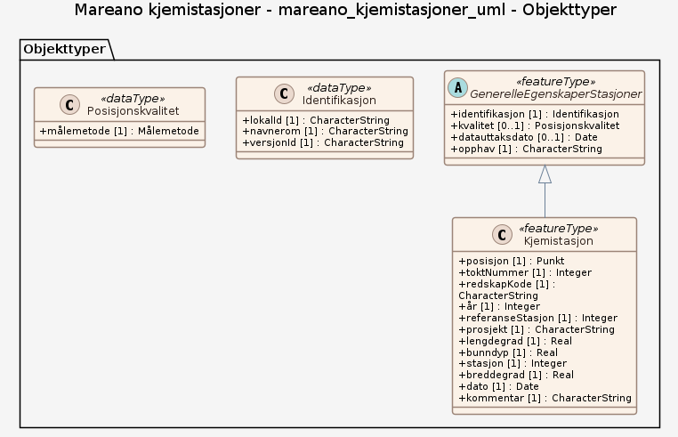

# Produktspesifikasjon: Mareano kjemistasjoner

*Datasettet viser posisjon der det er samlet inn sedimentprøver for analyse av kjemiske sammensetninger.
Mareanos Kjemiprogram er ansvarlig for innsamling, analyse og rapportering av havbunnssedimenter og deres kjemiske sammensetning inkl. utvalgte miljøgifter. Selve måledataene hentes fra datasettet Organiske miljøgifter i marine sedimenter.
Stasjoner med analyserte kjemiprøver pr. år. Årene 2006-2021 er prøvene samlet inn på Mareano-tokt, for 2003-2004 er de samlet inn på overvåkingstokt i Barentshavet og noen stasjoner i Marine grunnkart i kystsonen i 2020-2021.*

**Nøkkelord:** kjemiprøver, overvåkingstokt, sedimentprøver, kjemidata, Mareano, Norge digitalt, fellesDatakatalog, Kyst og fiskeri, Kjemistasjon, toktNummer, redskapKode, referanseStasjon, stasjon, bunndyp, kommentar, Norge

**Emnekategorier:** Kyst og sjø

**Geografisk utstrekning**:

- **Vest**: 1.0
- **Øst**: 37.17
- **Sør**: 58.5
- **Nord**: 81.75

**Geografisk område**:
Norske havområder.

**Tidsmessig utstrekning**:

- **Tidsperiode**:
  - **Fra**: 2021-04-09
  - **Til**: 2025-11-16

## Om spesifikasjonen

> **Denne versjonen av produktspesifikasjonen:**  
> **Opprettet dato:** 2021-04-09 
> **Endret dato:** 2025-11-16 
> **Språk:** nor 
> **Kontaktinformasjon:** Havforskningsinstituttet, [kjell.bakkeplass@hi.no](mailto:kjell.bakkeplass@hi.no)

## Om produktet Mareano kjemistasjoner

> **Romlig representasjonstype:** Vektor 
> **Unik identifikator:** <https://data.geonorge.no/sosi/kyst/mareano_kjemistasjoner> 
> **Kontaktinformasjon:** Havforskningsinstituttet, [kjell.bakkeplass@hi.no](mailto:kjell.bakkeplass@hi.no)
>
> **Romlig oppløsning:**
>
> **Ekvivalent målestokk**: 500000
>
> **Begrensninger:**
>
> **Ressursbegrensninger**:
>
> - **Bruksbegrensninger**: Ingen begrensninger på bruk er oppgitt.
>
> **Juridiske begrensninger**:
>
> - **Tilgangsbegrensninger**: Åpne data
> - **Bruksbegrensninger**: Lisens
> - **Lisens**: Norsk lisens for offentlige data (NLOD)
> - **Lisenslenke**: <http://data.norge.no/nlod/no/1.0>
>
> **Sikkerhetsbegrensninger**:
>
> - **Klassifisering**: Ugradert

### Formål

Datasettet viser hvor det er samlet inn sedimentprøver for analyser av organisk kjemi og kan brukes til bl.a. se om det er forurensning i områdene.

## Omfang

### Hele datasettet

**Nivå**: dataset

**Nivåbeskrivelse**: Gjelder hele datasettet. Hvis omfang ikke er oppgitt under en overskrift, gjelder teksten for hele datasettet og alle leveranser

### mareano_kjemistasjoner_uml

**Nivå**: dataset

## Datainnhold og struktur

### Datamodell - mareano_kjemistasjoner_uml

➡️ [Se full datamodell for omfang "mareano_kjemistasjoner_uml" (diagram per pakke og objektkatalog)](mareano-kjemistasjoner-uml/objektkatalog.html)

## Referansesystem

| EPSG-kode | Navn på referansesystem |
| --- | --- |
| [EPSG:25833](https://epsg.io/25833) | [EUREF89 UTM sone 33, 2d](https://register.geonorge.no/epsg-koder) |
| [EPSG:3035](https://epsg.io/3035) | [EUREF89 / ETRS89-LAEA Europe](https://register.geonorge.no/epsg-koder) |
| [EPSG:4258](https://epsg.io/4258) | [EUREF 89 Geografisk (ETRS 89) 2d](https://register.geonorge.no/epsg-koder) |

## Datakvalitet

**Nivå**: dataset

**Kvalitetsmål**: SOSI produktspesifikasjon: Mareano kjemistasjoner

- **Beskrivende resultat**: Dataene er i henhold til produktspesifikasjonen

**Kvalitetsmål**: Sosi applikasjonsskjema

- **Beskrivende resultat**: SOSI-filer er i henhold til applikasjonsskjema

**Kvalitetsmål**: Sosi applikasjonsskjema

- **Beskrivende resultat**: GML-filer er i henhold til applikasjonsskjema

**Kvalitetsmål**: Prosentvis oppfyllelse av FAIR-prinsipper

- **Målebeskrivelse**: Angir fullstendighet i forhold til krav fra FAIR-prinsippene (The FAIR Guiding Principles for scientific data management and stewardship)
- **Resultat**: 93

## Datafangst og produksjon

Datasettet er ikke heldekkende. Dekningsgrad avhenger av hvilken kartleggingsinnsats som er lagt ned innenfor de forskjellige områdene. Kjemistasjonen er angitt med posisjonen til skipet der sedimentprøven ble tatt. Dette gir en nøyaktighet på 10 meter, eventuelt avstand mellom skip og der redskapet traff bunnen. I noen tilfeller er det benyttet transponder på redskapet, noe som gir en bedre posisjonsangivelse. Datasettet egner seg til bruk i målestokk 500 000 - 10 000 000.

## Vedlikehold

**Vedlikeholdsfrekvens**: Årlig

**Status**: Fullført

## Presentasjon

**navn**: Tegneregler

**Lenke**:
<https://register.geonorge.no/register/versjoner/tegneregler/havforskningsinstituttet/mareano-kjemistasjoner>

## Leveranse

| Tjeneste | Endepunkt | Type | Format | Leveranseenheter |
| --- | --- | --- | --- | --- |
| Geonorge nedlastning | [Lenke](https://nedlasting.geonorge.no/api/capabilities/7bc25711-fc24-4a99-9e12-abbfb5de56cc) | GEONORGE:DOWNLOAD | FGDB, GML, PostGIS, SOSI | landsfiler |
| Atom Feed | [Lenke](http://nedlasting.geonorge.no/geonorge/ATOM-feeds/MareanoKjemistasjoner_AtomFeedFGDB.xml) | W3C:AtomFeed | FGDB | landsfiler |
| Atom Feed | [Lenke](http://nedlasting.geonorge.no/geonorge/ATOM-feeds/MareanoKjemistasjoner_AtomFeedGML.xml) | W3C:AtomFeed | GML | landsfiler |
| Atom Feed | [Lenke](http://nedlasting.geonorge.no/geonorge/ATOM-feeds/MareanoKjemistasjoner_AtomFeedPostGIS.xml) | W3C:AtomFeed | PostGIS | landsfiler |
| Atom Feed | [Lenke](http://nedlasting.geonorge.no/geonorge/ATOM-feeds/MareanoKjemistasjoner_AtomFeedSOSI.xml) | W3C:AtomFeed | SOSI | landsfiler |
| Mareano kjemistasjoner WMS | [Lenke](https://kart.hi.no/mareano/mareano_stasjoner/kjemistasjoner_aarlig/wms?service=WMS&request=GetCapabilities) | Tjenestelag | WMS-tjeneste |  |
| GeoPackage: mareano-kjemistasjoner-uml | [Lenke](https://raw.githubusercontent.com/ToreFreddyB/produktspesifikasjon_HI/main/produktspesifikasjon/mareano-kjemistasjoner/mareano-kjemistasjoner-uml/mareano-kjemistasjoner-uml.gpkg) | Nedlasting | GPKG |  |

## Metadata

**Metadatastandard**: ISO19115

**Metadatastandardversjon**: 2003

**Metadatadato**: 2026-10-25

**språk**: nor

**Kontakt**:

- **Organisasjon**: Havforskningsinstituttet
- **Kontaktperson**: Kjell Bakkeplass
- **Logo**: <https://register.geonorge.no/data/organizations/971349077_hi_liten.png>
- **Epost**: kjell.bakkeplass@hi.no
- **rolle**: pointOfContact

**Metadataidentifikator**:

- **Utsteder**: Geonorge
- **kode**: 7bc25711-fc24-4a99-9e12-abbfb5de56cc
- **koderom**: <https://kartkatalog.geonorge.no/metadata/>
- **Metadatalenke**: <https://kartkatalog.geonorge.no/metadata/7bc25711-fc24-4a99-9e12-abbfb5de56cc>

## Tilleggsinformasjon

- **Produktark:** [https://register.geonorge.no/register/versjoner/produktark/havforskningsinstituttet/mareano-kjemistasjoner](https://register.geonorge.no/register/versjoner/produktark/havforskningsinstituttet/mareano-kjemistasjoner)
- **Produktside:** [https://www.mareano.no](https://www.mareano.no)
