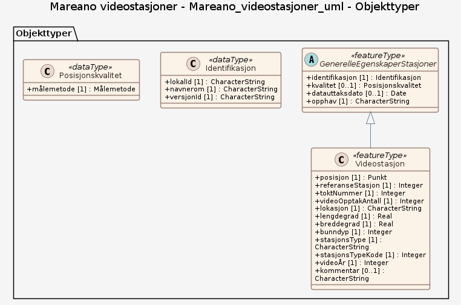

# Produktspesifikasjon: Mareano videostasjoner

*Datasettet viser referansestasjoner der MAREANO har samlet inn ett sett med visuelle bunnprøver fra videorigg for å observere geologi og bunnfauna. Referansestasjonen er som regel forhåndsbestemt før toktene utfra tolkning av data fra mulitistråleekkolodd.*

**Nøkkelord:** video, videoÅr, pr år, bunnfauna, mulitistråleekkolodd, Mareano, Norge digitalt, fellesDatakatalog, Kyst og fiskeri, Videostasjon, GenerelleEgenskaperStasjoner, referanseStasjon, toktNummer, videoOpptakAntall, lokasjon, bunndyp, stasjonsType, stasjonsTypeKode, Norge

**Emnekategorier:** Kyst og sjø

**Geografisk utstrekning**:

- **Vest**: 1.0
- **Øst**: 37.0
- **Sør**: 58.5
- **Nord**: 81.75

**Geografisk område**:
Norske havområder.

**Tidsmessig utstrekning**:

- **Tidsperiode**:
  - **Fra**: 2021-04-20
  - **Til**: 2026-05-24

## Om spesifikasjonen

> **Denne versjonen av produktspesifikasjonen:**  
> **Opprettet dato:** 2021-04-20 
> **Endret dato:** 2026-05-24 
> **Språk:** nor 
> **Kontaktinformasjon:** Havforskningsinstituttet, [kjell.bakkeplass@hi.no](mailto:kjell.bakkeplass@hi.no)

## Om produktet Mareano videostasjoner

> **Romlig representasjonstype:** Vektor 
> **Unik identifikator:** <https://data.geonorge.no/sosi/natur/mareno_videostasjoner> 
> **Kontaktinformasjon:** Havforskningsinstituttet, [kjell.bakkeplass@hi.no](mailto:kjell.bakkeplass@hi.no)
>
> **Romlig oppløsning:**
>
> **Ekvivalent målestokk**: 500000
>
> **Begrensninger:**
>
> **Ressursbegrensninger**:
>
> - **Bruksbegrensninger**: Ingen begrensninger på bruk er oppgitt.
>
> **Juridiske begrensninger**:
>
> - **Tilgangsbegrensninger**: Åpne data
> - **Bruksbegrensninger**: Lisens
> - **Lisens**: Norsk lisens for offentlige data (NLOD)
> - **Lisenslenke**: <http://data.norge.no/nlod/no/1.0>
>
> **Sikkerhetsbegrensninger**:
>
> - **Klassifisering**: Ugradert

### Formål

Datasettet viser hvor MAREANO har foretatt visuelle innsamlinger og brukes til å koble sammen de ulike prøvetakningene og antallet som er foretatt på denne referansestasjonen.

## Omfang

### Hele datasettet

**Nivå**: dataset

**Nivåbeskrivelse**: Gjelder hele datasettet. Hvis omfang ikke er oppgitt under en overskrift, gjelder teksten for hele datasettet og alle leveranser

### Mareano_videostasjoner_uml

**Nivå**: dataset

**Nivåbeskrivelse**: Datamodell (SOSI UML (XMI))

## Datainnhold og struktur

### Datamodell - Mareano_videostasjoner_uml

➡️ [Se full datamodell for omfang "Mareano_videostasjoner_uml" (diagram per pakke og objektkatalog)](mareano-videostasjoner-uml/objektkatalog.html)

## Referansesystem

| EPSG-kode | Navn på referansesystem |
| --- | --- |
| [EPSG:25833](https://epsg.io/25833) | [EUREF89 UTM sone 33, 2d](https://register.geonorge.no/epsg-koder) |
| [EPSG:3035](https://epsg.io/3035) | [EUREF89 / ETRS89-LAEA Europe](https://register.geonorge.no/epsg-koder) |
| [EPSG:4258](https://epsg.io/4258) | [EUREF 89 Geografisk (ETRS 89) 2d](https://register.geonorge.no/epsg-koder) |

## Datakvalitet

**Nivå**: dataset

**Kvalitetsmål**: SOSI produktspesifikasjon: Mareano - videostasjoner

- **Beskrivende resultat**: Dataene er i henhold til produktspesifikasjonen

**Kvalitetsmål**: Sosi applikasjonsskjema

- **Beskrivende resultat**: SOSI-filer er i henhold til applikasjonsskjema

**Kvalitetsmål**: Sosi applikasjonsskjema

- **Beskrivende resultat**: GML-filer er i henhold til applikasjonsskjema

**Kvalitetsmål**: Prosentvis oppfyllelse av FAIR-prinsipper

- **Målebeskrivelse**: Angir fullstendighet i forhold til krav fra FAIR-prinsippene (The FAIR Guiding Principles for scientific data management and stewardship)
- **Resultat**: 93

## Datafangst og produksjon

Datasettet er ikke heldekkende. Dekningsgrad avhenger av hvilken kartleggingsinnsats som er lagt ned innenfor de forskjellige områdene. Posisjonen er angitt som midtposisjonen for videotransektet. Datasettet egner seg til bruk i målestokk 500 000 - 10 000 000.

## Vedlikehold

**Vedlikeholdsfrekvens**: Etter behov

**Status**: Fullført

## Presentasjon

**navn**: Tegneregler

**Lenke**:
<https://register.geonorge.no/register/versjoner/tegneregler/havforskningsinstituttet/mareano-videostasjoner>

## Leveranse

| Tjeneste | Endepunkt | Type | Format | Leveranseenheter |
| --- | --- | --- | --- | --- |
| Geonorge nedlastning | [Lenke](https://nedlasting.geonorge.no/api/capabilities/8bb5b637-51a8-4f0d-905a-378493ae2354) | GEONORGE:DOWNLOAD | FGDB, GML, PostGIS, SOSI | landsfiler |
| Atom Feed | [Lenke](http://nedlasting.geonorge.no/geonorge/ATOM-feeds/MareanoVideostasjoner_AtomFeedFGDB.xml) | W3C:AtomFeed | FGDB | landsfiler |
| Atom Feed | [Lenke](http://nedlasting.geonorge.no/geonorge/ATOM-feeds/MareanoVideostasjoner_AtomFeedGML.xml) | W3C:AtomFeed | GML | landsfiler |
| Atom Feed | [Lenke](http://nedlasting.geonorge.no/geonorge/ATOM-feeds/MareanoVideostasjoner_AtomFeedPOSTGIS.xml) | W3C:AtomFeed | PostGIS | landsfiler |
| Atom Feed | [Lenke](http://nedlasting.geonorge.no/geonorge/ATOM-feeds/MareanoVideostasjoner_AtomFeedSOSI.xml) | W3C:AtomFeed | SOSI | landsfiler |
| Mareano videostasjoner WMS | [Lenke](https://kart.hi.no/mareano/mareano_stasjoner/videostasjoner_aarlig/wms?service=WMS&request=GetCapabilities) | Tjenestelag | PNG |  |
| GeoPackage: mareano-videostasjoner-uml | [Lenke](https://raw.githubusercontent.com/ToreFreddyB/produktspesifikasjon_HI/main/produktspesifikasjon/mareano-videostasjoner/mareano-videostasjoner-uml/mareano-videostasjoner-uml.gpkg) | Nedlasting | GPKG |  |

## Metadata

**Metadatastandard**: ISO19115

**Metadatastandardversjon**: 2003

**Metadatadato**: 2026-11-05

**språk**: nor

**Kontakt**:

- **Organisasjon**: Havforskningsinstituttet
- **Kontaktperson**: Kjell Bakkeplass
- **Logo**: <https://register.geonorge.no/data/organizations/971349077_hi_liten.png>
- **Epost**: kjell.bakkeplass@hi.no
- **rolle**: pointOfContact

**Metadataidentifikator**:

- **Utsteder**: Geonorge
- **kode**: 8bb5b637-51a8-4f0d-905a-378493ae2354
- **koderom**: <https://kartkatalog.geonorge.no/metadata/>
- **Metadatalenke**: <https://kartkatalog.geonorge.no/metadata/8bb5b637-51a8-4f0d-905a-378493ae2354>

## Tilleggsinformasjon

- **Produktark:** [https://register.geonorge.no/register/versjoner/produktark/havforskningsinstituttet/mareano-videostasjoner](https://register.geonorge.no/register/versjoner/produktark/havforskningsinstituttet/mareano-videostasjoner)
- **Produktside:** [https://www.mareano.no](https://www.mareano.no)
