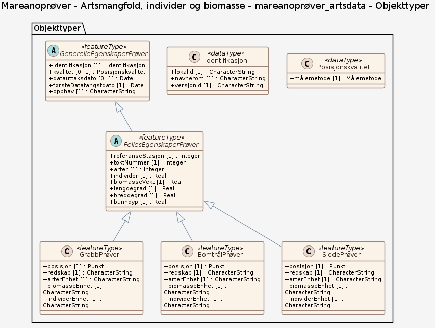

# Produktspesifikasjon: Mareanoprøver - Artsmangfold, individer og biomasse

*Tematisk datasettserie som består av datasett for «Artsmangfold, individer og biomasse» fra innsamlingsredskapene grabb, slede og bomtrål. Datasettet viser punkt med analyserte fysiske prøver fra grabb, slede og bomtrål (som er tematiske datasett). Datasettet viser artsmangfold (ved antall ulike arter), individer (aggregert sum av antall individer) og biomasse (aggregert verdi av individvekt).*

**Nøkkelord:** Grab, Bomtrål, Slede, Artsmangfold, Individer, Biomasse, Mareano, Norge digitalt, geodataloven, fellesDatakatalog, Natur, Kyst og fiskeri, GrabbPrøver, BomtrålPrøver, SledePrøver, redskap, arterEnhet, biomasseEnhet, individerEnhet, referanseStasjon, toktNummer, arter, biomasseVekt, bunndyp

**Emnekategorier:** Biologisk mangfold

**Geografisk utstrekning**:

- **Vest**: 3.0478
- **Øst**: 36.6208
- **Sør**: 62.3021
- **Nord**: 78.25275

**Geografisk område**:
Norske havområder

**Tidsmessig utstrekning**:

- **Tidsperiode**:
  - **Fra**: 2020-11-27
  - **Til**: 2025-02-11

## Om spesifikasjonen

> **Denne versjonen av produktspesifikasjonen:**  
> **Opprettet dato:** 2020-11-27 
> **Endret dato:** 2025-02-11 
> **Språk:** nor 
> **Kontaktinformasjon:** Havforskningsinstituttet, [kjell.bakkeplass@hi.no](mailto:kjell.bakkeplass@hi.no)

## Om produktet Mareanoprøver - Artsmangfold, individer og biomasse

> **Romlig representasjonstype:** Vektor 
> **Unik identifikator:** <https://data.geonorge.no/sosi/biomangfold/mareanoprover_artsmangfold_individer_biomasse> 
> **Kontaktinformasjon:** Havforskningsinstituttet, [kjell.bakkeplass@hi.no](mailto:kjell.bakkeplass@hi.no)
>
> **Romlig oppløsning:**
>
> **Ekvivalent målestokk**: 500000
>
> **Begrensninger:**
>
> **Ressursbegrensninger**:
>
> - **Bruksbegrensninger**: Ingen begrensninger på bruk er oppgitt.
>
> **Juridiske begrensninger**:
>
> - **Tilgangsbegrensninger**: Åpne data
> - **Bruksbegrensninger**: Lisens
> - **Lisens**: Norsk lisens for offentlige data (NLOD)
> - **Lisenslenke**: <http://data.norge.no/nlod/no/1.0>
>
> **Sikkerhetsbegrensninger**:
>
> - **Klassifisering**: Ugradert

### Formål

Datasettet viser artsmangfoldet ved havbunnen. Det bør tas hensyn til dette artsmangfoldet i forbindelsen med planlegging av aktiviteter som kan føre til forstyrrelser av artsmangfoldet.

### Bruksområde

Datasettet kan brukes som et verktøy for marin areal- og miljøplanlegging, sårbarhetsanalyser, habitatskartlegging og i forbindelse med installasjoner på havbunnen og aktiviteter som kan ha påvirkning på havbunnen. Videre kan datasettet brukes som beslutningsgrunnlag ved vurdering av nye oppdrettskonsesjoner, utslipp i sjø, deponering, utbygging av petroleumsrelaterte installasjoner, og regulering av fiskeriaktivitet.

## Omfang

### Hele datasettet

**Nivå**: dataset

**Nivåbeskrivelse**: Gjelder hele datasettet. Hvis omfang ikke er oppgitt under en overskrift, gjelder teksten for hele datasettet og alle leveranser

### mareanoprøver_artsdata

**Nivå**: dataset

**Nivåbeskrivelse**: Datamodell (SOSI UML (XMI))

## Datainnhold og struktur

### Datamodell - mareanoprøver_artsdata

➡️ [Se full datamodell for omfang "mareanoprøver_artsdata" (diagram per pakke og objektkatalog)](mareanoprver-artsdata/objektkatalog.html)

## Referansesystem

| EPSG-kode | Navn på referansesystem |
| --- | --- |
| [EPSG:25833](https://epsg.io/25833) | [EUREF89 UTM sone 33, 2d](https://register.geonorge.no/epsg-koder) |
| [EPSG:3035](https://epsg.io/3035) | [EUREF89 / ETRS89-LAEA Europe](https://register.geonorge.no/epsg-koder) |
| [EPSG:4258](https://epsg.io/4258) | [EUREF 89 Geografisk (ETRS 89) 2d](https://register.geonorge.no/epsg-koder) |

## Datakvalitet

**Nivå**: series

**Kvalitetsmål**: SOSI produktspesifikasjon: Mareanoprøver - Artsmangfold, individer og biomasse

- **Beskrivende resultat**: Dataene er i henhold til produktspesifikasjonen

**Kvalitetsmål**: Sosi applikasjonsskjema

- **Beskrivende resultat**: SOSI-filer er i henhold til applikasjonsskjema

**Kvalitetsmål**: Sosi applikasjonsskjema

- **Beskrivende resultat**: GML-filer er i henhold til applikasjonsskjema

**Kvalitetsmål**: Prosentvis oppfyllelse av FAIR-prinsipper

- **Målebeskrivelse**: Angir fullstendighet i forhold til krav fra FAIR-prinsippene (The FAIR Guiding Principles for scientific data management and stewardship)
- **Resultat**: 93

## Datafangst og produksjon

Bomtrål er en liten bunntrål som er utstyrt med et relativt grovt (ofte 2-5 mm) nett. Denne samler inn de større organismene som lever oppe på bunnen og litt ned i det øverste laget av sedimentene. I MAREANO sammenheng slepes bomtrålen vanligvis i 5 minutter langs bunnen. Slede (hyperbentisk slede) har en maskevidde som de groveste planktonhåvene (0.5 mm), og er beregnet for å samle inn små krepsdyr som lever like over bunnen. I MAREANO sammenheng slepes bomtrålen vanligvis i 15 minutter langs bunnen. MAREANO opparbeider den delen av prøvene som flyter opp når prøven samles i et kar med vann (dekantert fraksjon). Den øvrige delen av prøven det som synker til bunnen av karet samles inn og opparbeides videre av andre interesserte forskere. Det er kun krepsdyr fra den dekanterte fraksjonen av prøven som er representativ for kvantitative beregninger. Grabb (van Veen grabb) brukes for å ta prøver av dyrene som lever nede i sedimentene på havbunnen. Grabben tar et dypt «jafs» av havbunnen innenfor et areal som oftest er fra 0.1 til 0.25 m2, avhengig av grabbtype. Datasettet egner seg til bruk i målestokk 500 000 - 10 000 000.

## Vedlikehold

**Vedlikeholdsfrekvens**: Årlig

**Status**: Fullført

## Presentasjon

**navn**: Tegneregler

**Lenke**:
<https://register.geonorge.no/register/versjoner/tegneregler/havforskningsinstituttet/mareanoprøver-artsmangfold-individer-og-biomasse>

## Leveranse

| Tjeneste | Endepunkt | Type | Format | Leveranseenheter |
| --- | --- | --- | --- | --- |
| Geonorge nedlastning | [Lenke](https://nedlasting.geonorge.no/api/capabilities/58710d15-bad5-40e1-bcce-29c4b67cc787) | GEONORGE:DOWNLOAD | FGDB, GML, PostGIS, SOSI | landsfiler |
| Atom Feed | [Lenke](http://nedlasting.geonorge.no/geonorge/ATOM-feeds/MareanoproverArtsdata_AtomFeedFGDB.xml) | W3C:AtomFeed | FGDB | landsfiler |
| Atom Feed | [Lenke](http://nedlasting.geonorge.no/geonorge/ATOM-feeds/MareanoproverArtsdata_AtomFeedGML.xml) | W3C:AtomFeed | GML | landsfiler |
| Atom Feed | [Lenke](http://nedlasting.geonorge.no/geonorge/ATOM-feeds/MareanoproverArtsdata_AtomFeedPOSTGIS.xml) | W3C:AtomFeed | PostGIS | landsfiler |
| Atom Feed | [Lenke](http://nedlasting.geonorge.no/geonorge/ATOM-feeds/MareanoproverArtsdata_AtomFeedSOSI.xml) | W3C:AtomFeed | SOSI | landsfiler |
| GeoPackage: mareanoprver-artsdata | [Lenke](https://raw.githubusercontent.com/ToreFreddyB/produktspesifikasjon_HI/main/produktspesifikasjon/mareanoprover-artsmangfold-individer-og-biomasse/mareanoprver-artsdata/mareanoprver-artsdata.gpkg) | Nedlasting | GPKG |  |

## Metadata

**Metadatastandard**: ISO19115

**Metadatastandardversjon**: 2003

**Metadatadato**: 2026-11-12

**språk**: nor

**Kontakt**:

- **Organisasjon**: Havforskningsinstituttet
- **Kontaktperson**: Kjell Bakkeplass
- **Logo**: <https://register.geonorge.no/data/organizations/971349077_hi_liten.png>
- **Epost**: kjell.bakkeplass@hi.no
- **rolle**: pointOfContact

**Metadataidentifikator**:

- **Utsteder**: Geonorge
- **kode**: 58710d15-bad5-40e1-bcce-29c4b67cc787
- **koderom**: <https://kartkatalog.geonorge.no/metadata/>
- **Metadatalenke**: <https://kartkatalog.geonorge.no/metadata/58710d15-bad5-40e1-bcce-29c4b67cc787>

## Tilleggsinformasjon

- **Produktark:** [https://register.geonorge.no/register/versjoner/produktark/havforskningsinstituttet/mareanoprøver-artsmangfold-individer-og-biomasse](https://register.geonorge.no/register/versjoner/produktark/havforskningsinstituttet/mareanoprøver-artsmangfold-individer-og-biomasse)
- **Produktside:** [https://www.mareano.no/tema/biomangfold](https://www.mareano.no/tema/biomangfold)
