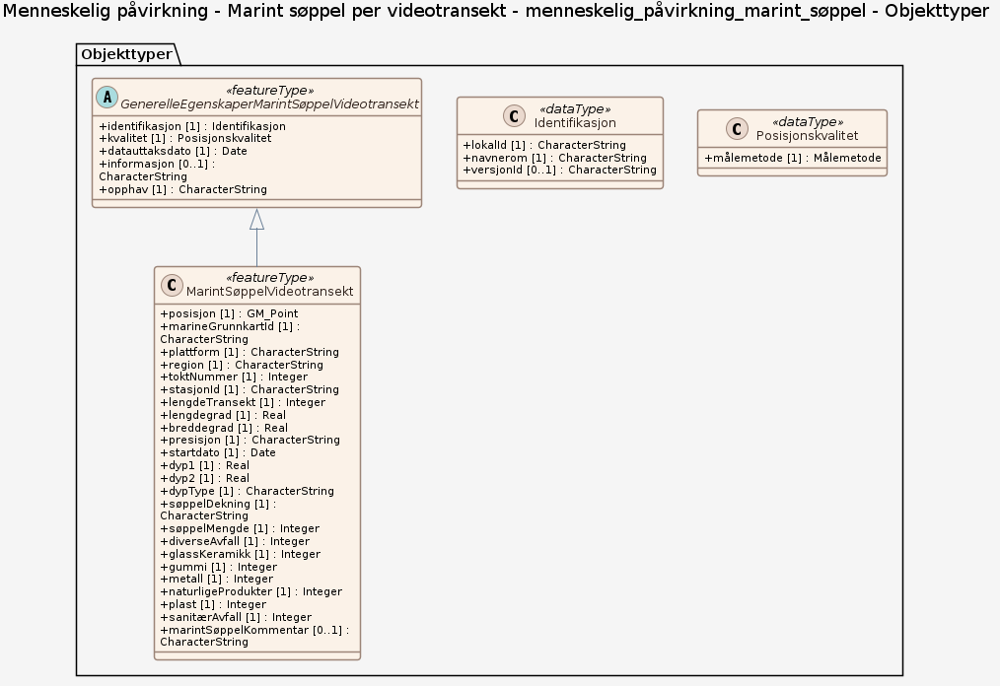

# Produktspesifikasjon: Menneskelig påvirkning - Marint søppel per videotransekt

*Datasettet er en del av prosjektet «Marine Grunnkart i Kystsonen», og viser antall observerte objekter (større enn 5 cm) på havbunnen som er kategorisert som søppel. Under søppel inngår alle elementer som er menneskeskapte, ikke inkludert fiskeredskap.  
Datasettet er basert på videoanalyse og dekker enkelte kystområder der kartleggingsprosjektet Marine Grunnkart i Kystsonen har samlet inn videomateriale.*

**Nøkkelord:** Marine grunnkart i kystsonen, Natur i Norge, Marint søppel, Boss, Plast, Avfall, Norge digitalt, MarineGrunnkart, fellesDatakatalog, Kyst og fiskeri, Natur, Norge

**Emnekategorier:** Biologisk mangfold

**Geografisk utstrekning**:

- **Vest**: 2.0
- **Øst**: 30.0
- **Sør**: 58.0
- **Nord**: 72.0

**Geografisk område**:
Fjorder og kystnære havområder langs norskekysten.

**Tidsmessig utstrekning**:

- **Tidsperiode**:
  - **Fra**: 2021-12-22
  - **Til**: 2026-10-01

## Om spesifikasjonen

> **Denne versjonen av produktspesifikasjonen:**  
> **Opprettet dato:** 2021-12-22 
> **Endret dato:** 2026-10-01 
> **Språk:** nor 
> **Kontaktinformasjon:** Havforskningsinstituttet, [genoveva.gonzalez-mirelis@hi.no](mailto:genoveva.gonzalez-mirelis@hi.no)

## Om produktet Menneskelig påvirkning - Marint søppel per videotransekt

> **Romlig representasjonstype:** Vektor 
> **Unik identifikator:** <https://data.geonorge.no/sosi/forurensning/menneskelig_pavirkning_marint_soppel> 
> **Kontaktinformasjon:** Havforskningsinstituttet, [genoveva.gonzalez-mirelis@hi.no](mailto:genoveva.gonzalez-mirelis@hi.no)
>
> **Romlig oppløsning:**
>
>
>
> **Begrensninger:**
>
> **Ressursbegrensninger**:
>
> - **Bruksbegrensninger**: Ingen begrensninger på bruk er oppgitt.
>
> **Juridiske begrensninger**:
>
> - **Tilgangsbegrensninger**: Åpne data
> - **Bruksbegrensninger**: Lisens
> - **Lisens**: Creative Commons BY 4.0 (CC BY 4.0)
> - **Lisenslenke**: <https://creativecommons.org/licenses/by/4.0/>
>
> **Sikkerhetsbegrensninger**:
>
> - **Klassifisering**: Ugradert

### Formål

Datasettet kan anvendes som et underlag i forbindelse med opprydning av havbunnen, og for å øke kunnskapen angående hvilke områder langs kystsonen som er sterkt forsøplet.

## Omfang

### Hele datasettet

**Nivå**: dataset

**Nivåbeskrivelse**: Gjelder hele datasettet. Hvis omfang ikke er oppgitt under en overskrift, gjelder teksten for hele datasettet og alle leveranser

### menneskelig_påvirkning_marint_søppel

**Nivå**: dataset

## Datainnhold og struktur

### Datamodell - menneskelig_påvirkning_marint_søppel

➡️ [Se full datamodell for omfang "menneskelig_påvirkning_marint_søppel" (diagram per pakke og objektkatalog)](menneskelig-pavirkning-marint-sppel/objektkatalog.html)

## Referansesystem

| EPSG-kode | Navn på referansesystem |
| --- | --- |
| [EPSG:25833](https://epsg.io/25833) | [EUREF89 UTM sone 33, 2d](https://register.geonorge.no/epsg-koder) |
| [EPSG:3035](https://epsg.io/3035) | [EUREF89 / ETRS89-LAEA Europe](https://register.geonorge.no/epsg-koder) |
| [EPSG:4258](https://epsg.io/4258) | [EUREF 89 Geografisk (ETRS 89) 2d](https://register.geonorge.no/epsg-koder) |

## Datakvalitet

**Nivå**: dataset

**Kvalitetsmål**: Prosentvis oppfyllelse av FAIR-prinsipper

- **Målebeskrivelse**: Angir fullstendighet i forhold til krav fra FAIR-prinsippene (The FAIR Guiding Principles for scientific data management and stewardship)
- **Resultat**: 82

## Vedlikehold

**Vedlikeholdsfrekvens**: Etter behov

**Status**: Kontinuerlig oppdatert

## Leveranse

| Tjeneste | Endepunkt | Type | Format | Leveranseenheter |
| --- | --- | --- | --- | --- |
| Geonorge nedlastning | [Lenke](https://nedlasting.geonorge.no/api/capabilities/cadd7b67-892b-44cb-8d9c-9cdf92d6d92b) | GEONORGE:DOWNLOAD | FGDB, GML, PostGIS, SOSI | landsfiler |
| Atom Feed | [Lenke](http://nedlasting.geonorge.no/geonorge/ATOM-feeds/MarintSoppel_AtomFeedFGDB.xml) | W3C:AtomFeed | FGDB | landsfiler |
| Atom Feed | [Lenke](http://nedlasting.geonorge.no/geonorge/ATOM-feeds/MarintSoppel_AtomFeedGML.xml) | W3C:AtomFeed | GML | landsfiler |
| Atom Feed | [Lenke](http://nedlasting.geonorge.no/geonorge/ATOM-feeds/MarintSoppel_AtomFeedPostGIS.xml) | W3C:AtomFeed | PostGIS | landsfiler |
| Atom Feed | [Lenke](http://nedlasting.geonorge.no/geonorge/ATOM-feeds/MarintSoppel_AtomFeedSOSI.xml) | W3C:AtomFeed | SOSI | landsfiler |
| Menneskelig påvirkning - Marint søppel per videotransekt, WMS | [Lenke](https://kart.hi.no/mareano/magik/menneske_soppel/ows?request=GetCapabilities&service=WMS) | Tjenestelag | ESRI Shape |  |
| GeoPackage: menneskelig-pavirkning-marint-sppel | [Lenke](https://raw.githubusercontent.com/ToreFreddyB/produktspesifikasjon_HI/main/produktspesifikasjon/menneskelig-pavirkning-marint-soppel-per-videotransekt/menneskelig-pavirkning-marint-sppel/menneskelig-pavirkning-marint-sppel.gpkg) | Nedlasting | GPKG |  |

## Metadata

**Metadatastandard**: ISO19115

**Metadatastandardversjon**: 2003

**Metadatadato**: 2026-11-13

**språk**: nor

**Kontakt**:

- **Organisasjon**: Havforskningsinstituttet
- **Kontaktperson**: Barbro Taraldset Haugland
- **Logo**: <https://register.geonorge.no/data/organizations/971349077_hi_liten.png>
- **Epost**: barbroth@hi.no
- **rolle**: pointOfContact

**Metadataidentifikator**:

- **Utsteder**: Geonorge
- **kode**: cadd7b67-892b-44cb-8d9c-9cdf92d6d92b
- **koderom**: <https://kartkatalog.geonorge.no/metadata/>
- **Metadatalenke**: <https://kartkatalog.geonorge.no/metadata/cadd7b67-892b-44cb-8d9c-9cdf92d6d92b>

## Tilleggsinformasjon

Innsamling av videomateriale er gjort av Norges geologiske undersøkelse (NGU) og Havforskningsinstituttet (HI). Videomateriale er tolket og digitalisering av HI. 
Datasettet er basert på tolkning av videomateriale av overflaten av havbunnen, samlet inn ved hjelp av ROV, drop-kamera og undervannsdrone, avhengig av dybde. Opptak av havbunnens overflate ble gjort langs 50 m lange transekter. Alle objekter identifisert som søppel (ikke inkludert fiskeredskap eller objekter plassert med vilje, f.eks. kabler) og større enn 5 cm ble registrert langs hvert transekt. Variabelen ‘søppeldekning’ er numerisk. Hvert punktsymbol er plottet på koordinatene for transektets midtpunkt, hvor symbolets størrelse korresponderer med antall søppelobjekter.

- **Produktark:** [https://register.geonorge.no/register/versjoner/produktark/havforskningsinstituttet/marint-søppel-per-videotransekt](https://register.geonorge.no/register/versjoner/produktark/havforskningsinstituttet/marint-søppel-per-videotransekt)
- **Produktside:** [https://www.kartverket.no/geodataarbeid/marine-grunnkart-i-kystsonen](https://www.kartverket.no/geodataarbeid/marine-grunnkart-i-kystsonen)
